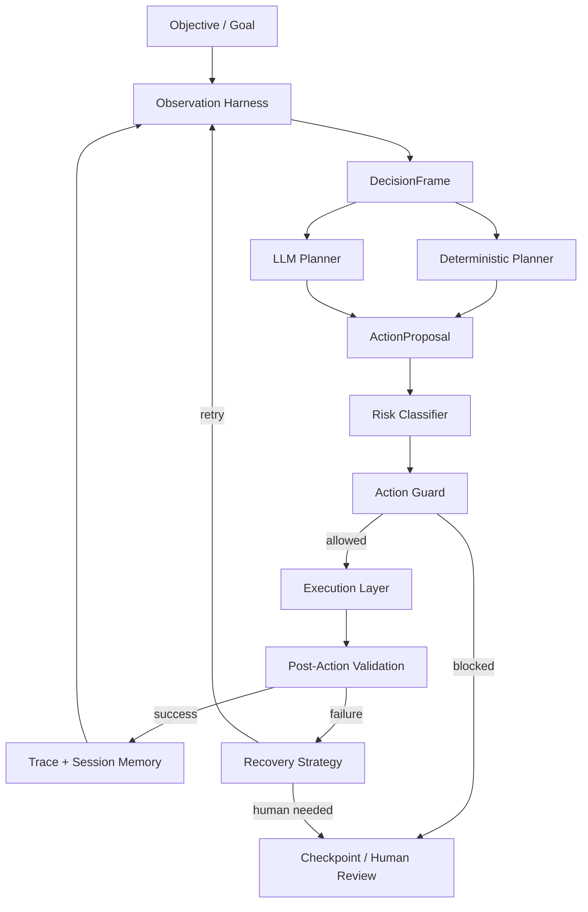

# JobPilot Agent Harness Architecture

Este documento define a direcao tecnica para transformar o JobPilot em um runtime profissional de agente de navegador para candidaturas. A ideia central nao e construir um bot hardcoded para LinkedIn, nem um agente generico solto demais. O objetivo e um harness forte: ele observa, estrutura, orienta o modelo, valida cada decisao, executa de forma atomica, verifica o resultado e para quando nao ha seguranca suficiente.

## Resumo Executivo

O JobPilot esta no caminho certo porque ja tem pecas essenciais de um agente serio:

- observacao estruturada da pagina;
- schema e validacao para decisoes da LLM;
- validacao contra elementos realmente observados;
- bloqueio de acoes incompativeis;
- guardrails antes de navegacao e submit;
- checkpoint em incerteza;
- validacao pos-acao;
- memoria curta da sessao;
- auditoria e evidencias.

O risco arquitetural atual nao e "falta de LLM". O risco e deixar responsabilidades misturadas: plataforma, observacao, decisao, validacao, execucao, recuperacao e auditoria dentro de poucos componentes grandes. O proximo salto profissional e formalizar o loop de decisao como um pipeline explicito, com contratos claros e objetos intermediarios auditaveis.

## Status de Implementacao

A arquitetura descrita aqui esta implementada no produto em uma primeira versao end-to-end:

- `apps/agent/Application/AgentLoopContracts.cs` define `DecisionFrame`, `ObservationFrame`, `ActionProposal`, `ApprovedAction`, `ActionVerdict`, `ActionOutcome`, `FailureRecord`, `RecoveryDecision`, `ActionRisk`, `RiskBudget`, `ObservedContentSafetyReport` e redaction de trace.
- `ActionRiskClassifier`, `ObservedContentSafetyScanner`, `TraceRedactor`, `BrowserActionGuard.Evaluate`, `PostActionValidator.ValidateOutcome` e `RecoveryEngine` compoem o loop estruturado.
- `IPlatformModule`, `PlatformRegistry`, `GenericPlatformModule` e `LinkedInPlatformModule` separam comportamento de plataforma. LinkedIn continua funcionando via `LinkedInApplicationFlow`, `LinkedInObservationExtension` e `LinkedInNavigator`, mas o core chama o modulo em vez de codificar a regra.
- `LinkedInNavigator` virou uma facade de compatibilidade; login, discovery, browser context e abertura do Easy Apply/externo foram separados em servicos de plataforma.
- LinkedIn `Candidatar-se` nao e mais tratado como falha manual por padrao: o modulo abre popup/nova aba ou navegacao na mesma aba, registra `linkedin.external_apply_opened`, e entrega o formulario externo ao `GenericPlatformModule`.
- `IBrowserDriver` foi separado de `IObservationDriver`; `BrowserExtensionDriver` implementa um adapter pronto sobre `IBrowserExtensionTransport` para uma extensao futura atuar como driver/observador, nao como cerebro.
- A API persiste `AgentTraceStep`, redige payloads sensiveis, agrega trace na auditoria e conecta checkpoints a run/trace quando possivel.
- O frontend exibe timeline tecnica expansivel por candidatura, com resumo operacional, filtros, busca e fallback para audit legado.
- Os testes incluem golden traces para checkpoint de submit generico e prompt injection, alem de fixtures HTML para multi-step, validacao escondida, custom select/upload e prompt injection.

O trabalho restante e evolutivo: ligar a extensao MV3 real ao transporte do runtime e continuar enriquecendo golden traces para fluxos reais de ATS/plataformas.

## Principios

1. O core deve ser universal.
   O core deve entender formularios, campos, botoes, estados, riscos, politicas, validacao e checkpoints sem conhecer LinkedIn, Gupy, Vagas.com ou outro site.

2. Plataformas sao aceleradores, nao muletas.
   Um adaptador de plataforma deve melhorar precisao para abrir candidatura, detectar login, localizar superficie ativa e normalizar componentes estranhos. Sem adaptador, o core ainda deve operar com cautela em modo generico.

3. A LLM nunca executa.
   A LLM propoe uma acao estruturada. O harness valida. O browser driver executa. O validador confirma. Essa separacao e fundamental.

4. Browser extension e transporte principal, nao cerebro.
   A extensao de navegador melhora observacao, IDs estaveis, sessoes reais e eventos de DOM, mas nao deve conter politica, decisao, risco ou guardrails centrais. Ela implementa contratos de driver/observacao.

5. Toda acao deve ser atomica.
   O loop deve preferir uma acao pequena por iteracao: preencher um campo, selecionar uma opcao, clicar em avancar, rolar, esperar ou checkpoint.

6. Falha deve fechar em seguranca.
   Se nao ha alvo observado, valor confiavel, politica permitindo ou validacao pos-acao, o resultado correto e recuperar de forma controlada ou criar checkpoint.

7. Submit e uma fronteira de risco.
   Enviar candidatura deve exigir nivel maior de confianca, estado limpo, politica permissiva e evidencia suficiente.

8. Observabilidade e parte do produto.
   O sistema precisa explicar o que viu, por que escolheu uma acao, quem autorizou, o que mudou depois e onde ficou bloqueado.

## Referencias Externas

As decisoes deste documento seguem padroes recorrentes em frameworks e produtos modernos de agentes:

- A documentacao de computer use da Anthropic descreve o nucleo como um agent loop no qual o modelo pede uso de ferramenta, a aplicacao executa, devolve o resultado e o ciclo continua ate concluir ou atingir limite. Tambem enfatiza ambiente controlado e que a aplicacao, nao o modelo, executa as ferramentas. Fonte: [Anthropic Computer Use](https://docs.anthropic.com/en/docs/agents-and-tools/tool-use/computer-use-tool).
- A documentacao do OpenAI Agents SDK trata agentes como modelos configurados com ferramentas, guardrails, handoffs, structured outputs e tracing. O loop reexecuta quando ha chamadas de ferramenta ou handoff. A documentacao tambem diferencia guardrails por agente e por ferramenta, o que e relevante para o JobPilot porque cada acao de browser deve ser protegida antes da execucao. Fontes: [OpenAI Agents](https://openai.github.io/openai-agents-python/agents/), [Running Agents](https://openai.github.io/openai-agents-python/running_agents/), [Guardrails](https://openai.github.io/openai-agents-python/guardrails/), [Tracing](https://openai.github.io/openai-agents-python/tracing/).
- A documentacao de LangGraph destaca persistencia/checkpoints para human-in-the-loop, retomada, memoria, debug temporal e tolerancia a falhas. Fonte: [LangGraph Persistence](https://docs.langchain.com/oss/python/langgraph/persistence).
- A documentacao do Microsoft AutoGen/Agent Framework destaca observabilidade via tracing/OpenTelemetry e padroes de human-in-the-loop em runtimes agenticos. Isso reforca que logs soltos sao insuficientes para um agente operacional. Fontes: [AutoGen Tracing](https://microsoft.github.io/autogen/stable/user-guide/agentchat-user-guide/tracing.html), [Microsoft Agent Framework Migration Guide](https://learn.microsoft.com/ro-ro/agent-framework/migration-guide/from-autogen/).
- A documentacao atual de agentes tambem chama atencao para privacidade de trace, incluindo opcoes para excluir dados sensiveis de entradas/saidas de LLM e ferramentas. Para JobPilot, isso vira requisito: traces precisam ser ricos, mas nao podem vazar senhas, tokens, CPF, dados sensiveis ou respostas pessoais alem do necessario.

A conclusao para o JobPilot: o harness deve ser um runtime duravel e auditavel, conectado a uma extensao de navegador, nao uma automacao opaca de browser.

## Estado Atual do Projeto

### Pecas fortes ja existentes

- `ApplicationAgent`: orquestra o ciclo de candidatura.
- `PageObserver`: coleta URL, titulo, texto visivel, elementos, modal ativo, scroll e candidatos de acao.
- `IPageObservationExtension`: permite extensoes por plataforma para superficie ativa e normalizacao.
- `LinkedInObservationExtension`: concentra regras de superficie ativa do LinkedIn.
- `IApplicationPlatformFlow`: separa navegacao e abertura da candidatura por plataforma.
- `LinkedInApplicationFlow`: moveu a preparacao do Easy Apply para fora do agente central.
- `LlmDecisionEngine`: envolve o LLM com fallback local e validacao de seguranca.
- `DecisionEngine`, `ActionPlanner`, `FormAuditor`, `FieldValuePolicy`: aplicam regras locais antes ou depois do LLM.
- `BrowserActionGuard`: bloqueia alvos inexistentes, acoes incompativeis e navegacao com campos obrigatorios pendentes.
- `PostActionValidator`: confirma efeitos depois de fill, select e navegacao.
- `SessionContext`: evita repeticao, registra valores usados e memoria curta de decisoes.
- `FormStateMachine`: acompanha fase, stuck state, confirmacao e bloqueios.
- `JobPilotApiClient`: registra eventos, passos, checkpoints, respostas, campos, memoria e learnings.

### Pontos ainda misturados

- `ApplicationAgent` ainda lida diretamente com `IPage` e alguns detalhes Playwright.
- `LinkedInNavigator` mistura descoberta, login e abertura do Easy Apply.
- O loop ainda passa `PageObservation` e `BrowserAction` diretamente, sem um objeto formal de decisao intermediaria.
- O risco de uma acao esta espalhado entre planner, policy, guard, auditor e submit policy.
- O trace existe como eventos e steps, mas ainda nao ha um envelope unico por iteracao.
- A recuperacao de falhas ainda e mais procedural do que uma estrategia classificada.

## Analise de Impacto no Projeto Inteiro

Esta arquitetura nao e uma mudanca isolada em `ApplicationAgent`. Para chegar no produto desejado, a implementacao pode e deve mexer em qualquer area necessaria do projeto, desde que preserve comportamento atual por testes e mantenha os guardrails existentes.

Regra de implementacao: tratar JobPilot como produto inteiro. Mudanca de modelagem sem API, API sem frontend, frontend sem contrato, ou agente sem auditoria visual e implementacao incompleta. Cada refatoracao relevante deve percorrer o fluxo completo: dominio/modelagem, persistencia, endpoints, cliente TypeScript, UI, testes e docs.

### `apps/agent`

Mudancas esperadas:

- Criar contratos do loop: `DecisionFrame`, `ObservationFrame`, `ActionProposal`, `ApprovedAction`, `ActionVerdict`, `ActionOutcome`, `FailureRecord`, `RecoveryDecision`, `ActionRisk`.
- Transformar planners em geradores de propostas, nao executores implicitos.
- Fazer o guard produzir verdict estruturado.
- Fazer o executor aceitar somente acao aprovada.
- Fazer o validador pos-acao produzir outcome estruturado.
- Inserir `ActionRiskClassifier`.
- Inserir `ObservedContentSafetyScanner`.
- Criar `PlatformModule` e `PlatformRegistry`.
- Criar `GenericPlatformModule`.
- Transformar LinkedIn em `LinkedInPlatformModule`.
- Dividir ou preparar divisao de `LinkedInNavigator` em discovery, login e Easy Apply/surface.
- Reduzir dependencia direta de `IPage` no core.
- Conectar o `BrowserExtensionDriver` ao transporte real da extensao.

Partes que provavelmente serao tocadas:

- `apps/agent/Application`
- `apps/agent/Browser`
- `apps/agent/Harness`
- `apps/agent/Platforms`
- `apps/agent/Discovery`
- `apps/agent/Domain/Dtos.cs`

Diagnostico atual:

- O loop principal ainda trabalha com `PageObservation` e `BrowserAction` como objetos centrais.
- `ApplicationAgent` ja esta mais fino, mas ainda e responsavel por montar parte do ciclo operacional e ainda recebe `IPage`.
- `LlmDecisionEngine` faz loop de correcao da LLM, mas retorna `BrowserAction` diretamente.
- `DecisionEngine`/`ActionPlanner` misturam decisao deterministica com acao executavel.
- `BrowserActionGuard` retorna boolean + reason, nao um verdict estruturado.
- `PostActionValidator` retorna `ActionExecutionResult`, mas ainda nao representa before/after, expected effect, failure class, recovery hint e outcome detalhado.
- `LinkedInNavigator` ainda acumula discovery, login e Easy Apply.

Estado alvo:

- `ApplicationAgent` vira orquestrador de runtime.
- `AgentRuntime` ou equivalente executa o loop usando frames, proposals, verdicts e outcomes.
- Planners produzem `ActionProposal`.
- Guard produz `ActionVerdict`.
- Executor aceita somente `ApprovedAction`.
- Validator produz `ActionOutcome`.
- Recovery decide proxima estrategia com base em `ActionOutcome`.
- Platform registry resolve `LinkedInPlatformModule` ou `GenericPlatformModule`.
- Browser driver fica centrado na extensao, com adapter legado apenas para desenvolvimento/teste.

### `apps/api`

Hoje a API ja guarda `AgentRun`, `AgentStep`, `ExecutionEvent`, `Checkpoint`, `ApplicationField`, `ApplicationAnswer`, `SiteWorkflowMemory` e `AgentLearning`. Para o harness profissional, isso precisa evoluir de eventos soltos para trace estruturado.

Mudancas esperadas:

- Ampliar `AgentStep` ou criar uma entidade nova, como `AgentTraceStep`.
- Persistir dados por iteracao:
  - objective;
  - platform/module;
  - before fingerprint;
  - after fingerprint;
  - planner usado;
  - proposal JSON;
  - risk JSON;
  - guard verdict JSON;
  - execution JSON;
  - outcome JSON;
  - recovery JSON;
  - content safety report JSON;
  - evidence path.
- Criar request DTOs especificos para trace rico.
- Atualizar endpoints de `/api/agent/steps` ou criar `/api/agent/trace-steps`.
- Atualizar `ApplicationAuditService` para retornar trace junto com fields, answers, checkpoints, events e learnings.
- Adicionar migrations se novos campos/tabelas forem criados.
- Manter compatibilidade com os dados atuais quando possivel.

Partes que provavelmente serao tocadas:

- `apps/api/Domain/Entities.cs`
- `apps/api/Data/JobPilotDbContext.cs`
- `apps/api/Data/Migrations`
- `apps/api/Endpoints/AgentEndpoints.cs`
- `apps/api/Endpoints/ApplicationAuditEndpoints.cs`
- `apps/api/Services/ApplicationAuditService.cs`
- testes em `apps/api.tests`

Diagnostico atual:

- `AgentRun` representa uma execucao, mas nao carrega resumo de plataforma, objetivo ou contadores ricos.
- `AgentStep` e um resumo simples: step, pageState, actionType, targetLabel, result, evidencePath, confidence.
- `ExecutionEvent` e texto livre, bom para log, mas fraco para auditoria estruturada.
- `Checkpoint` guarda motivo e detalhe, mas nao se conecta formalmente a proposal/verdict/outcome.
- `ApplicationAuditService` agrega fields, answers, steps, checkpoints, events e learnings, mas nao trace rico.
- `AgentEndpoints` ainda contem endpoints antigos de harness LLM (`page-state`, `step-validation`, `browser-action-plan`, `resolve-answer`) que podem continuar por compatibilidade, mas o novo runtime deve ter contratos mais estruturados.

Estado alvo:

- Criar `AgentTraceStep` ou ampliar `AgentStep` com JSON estruturado, preferencialmente nova tabela se o payload crescer.
- Todo step deve poder ser reconstruido sem depender de parsing de strings.
- O endpoint de auditoria deve retornar uma visao agregada: resumo antigo + trace rico.
- Checkpoints devem referenciar, quando possivel, trace step/run e failure class.
- API deve validar tamanho e sensibilidade dos JSONs salvos.
- Migrations devem manter dados antigos funcionando.

Modelo sugerido:

```csharp
public class AgentTraceStep
{
    public Guid Id { get; set; }
    public Guid UserId { get; set; }
    public Guid? AgentRunId { get; set; }
    public Guid? ApplicationJobId { get; set; }
    public int StepNumber { get; set; }
    public string ObjectiveKind { get; set; } = "";
    public string Platform { get; set; } = "";
    public string Phase { get; set; } = "";
    public string BeforeFingerprint { get; set; } = "";
    public string AfterFingerprint { get; set; } = "";
    public string Planner { get; set; } = "";
    public string ProposalJson { get; set; } = "{}";
    public string RiskJson { get; set; } = "{}";
    public string GuardVerdictJson { get; set; } = "{}";
    public string ExecutionJson { get; set; } = "{}";
    public string OutcomeJson { get; set; } = "{}";
    public string RecoveryJson { get; set; } = "{}";
    public string ContentSafetyJson { get; set; } = "{}";
    public string EvidencePath { get; set; } = "";
    public DateTimeOffset CreatedAt { get; set; } = DateTimeOffset.UtcNow;
}
```

### `apps/web`

O painel atual mostra eventos, steps, campos, respostas, checkpoints e learnings. Com o novo harness, ele deve conseguir mostrar uma timeline de decisao mais rica.

Mudancas esperadas:

- Atualizar tipos TypeScript para trace estruturado.
- Mostrar por step:
  - objetivo;
  - pagina/estado;
  - proposta;
  - risco;
  - verdict do guard;
  - resultado de execucao;
  - outcome pos-acao;
  - checkpoint/recovery;
  - sinais de prompt injection, se houver.
- Diferenciar visualmente:
  - local planner;
  - LLM planner;
  - learning;
  - recovery;
  - checkpoint;
  - blocked by guard;
  - submit boundary.
- Expor evidencias sem vazar segredos desnecessarios.
- Manter visao simples para usuario, mas permitir debug tecnico quando necessario.

Partes que provavelmente serao tocadas:

- `apps/web/src/types.ts`
- `apps/web/src/hooks/useJobAudit.ts`
- `apps/web/src/App.tsx`
- `apps/web/src/constants/labels.ts`

Diagnostico atual:

- `types.ts` possui `AuditStep`, `AuditField`, `AuditAnswer`, `AuditCheckpoint`, `AuditEvent` e `JobAudit`, mas nao possui `AgentTraceStep`.
- `useJobAudit.ts` carrega varias listas separadas por endpoints antigos de job audit.
- `JobDetailCard` mostra abas `Passos`, `Campos`, `Respostas`, `Checkpoints`, `Aprendizados`, `Eventos`.
- A aba `Passos` exibe `actionType`, `pageState`, `targetLabel`, `result`, `confidence`; isso nao mostra proposal, risk, verdict, outcome ou recovery.
- `AgentTab` mostra eventos e historico resumido, mas nao timeline tecnica do loop.
- `labels.ts` nao possui labels para risk level, planner, guard verdict, outcome status, recovery decision ou content safety.

Estado alvo:

- `JobAudit` deve incluir `traceSteps`.
- `useJobAudit` deve buscar `/application-jobs/{id}/audit` ou endpoint equivalente que ja traga tudo, evitando varias chamadas paralelas quando o trace ficar maior.
- `JobDetailCard` deve ganhar aba `Timeline` ou substituir `Passos` por uma timeline expansivel.
- A UI deve preservar leitura rapida: cada step com status, risco, planner, action e outcome.
- Detalhes tecnicos devem ficar em expand/collapse ou JSON viewer.
- `AgentTab` deve mostrar visao operacional geral; `JobDetailCard` deve mostrar timeline especifica da candidatura.
- `labels.ts` deve mapear novos enums.

Tipos TypeScript sugeridos:

```ts
export type AgentTraceStep = {
  id: string
  agentRunId?: string
  applicationJobId?: string
  stepNumber: number
  objectiveKind: string
  platform: string
  phase: string
  beforeFingerprint: string
  afterFingerprint: string
  planner: string
  proposalJson: string
  riskJson: string
  guardVerdictJson: string
  executionJson: string
  outcomeJson: string
  recoveryJson: string
  contentSafetyJson: string
  evidencePath: string
  createdAt: string
}

export type JobAudit = {
  fields: AuditField[]
  answers: AuditAnswer[]
  steps: AuditStep[]
  traceSteps: AgentTraceStep[]
  checkpoints: AuditCheckpoint[]
  events: AuditEvent[]
  learnings: AgentLearning[]
}
```

O frontend nao e opcional. Se a API passar a retornar `AgentTraceStep`, `ActionVerdict`, `ActionOutcome`, risco, recovery ou content safety report, o web deve expor isso de forma utilizavel. O painel deve continuar simples para operacao diaria, mas precisa ter uma visao tecnica expansivel para entender o loop de decisao.

Requisitos de UI para o harness:

- timeline por candidatura;
- filtros por run, step, risco, planner, outcome e checkpoint;
- destaque visual para `blocked_by_guard`, `needs_review`, `ready_for_submit`, `applied` e `failed`;
- visualizacao compacta de proposal/verdict/outcome;
- links para evidencia/screenshot quando disponivel;
- secao de seguranca mostrando sinais de prompt injection ou conteudo fora do objetivo;
- indicacao clara de qual plataforma/modulo atuou;
- estado vazio e erro de carregamento bem definidos;
- compatibilidade com dados antigos quando trace rico ainda nao existir.

### Banco de dados e migracoes

Se a implementacao criar `AgentTraceStep` ou novos campos em `AgentStep`, deve haver migration. A decisao entre estender `AgentStep` ou criar nova tabela deve considerar:

- compatibilidade com UI atual;
- facilidade de query por candidatura;
- volume de JSON por step;
- possibilidade de exportar trace no futuro;
- evitar quebrar historico existente.

Recomendacao inicial: criar uma entidade/tabela nova para trace rico se o payload ficar grande, mantendo `AgentStep` como resumo compativel.

Toda migration de trace deve ter caminho correspondente no frontend. Se um campo for persistido apenas para nunca ser exibido nem usado em auditoria, ele deve ser questionado.

### Testes

A mudanca exige testes alem dos atuais.

Areas obrigatorias:

- contratos do loop;
- risk classifier;
- observed content safety scanner;
- platform registry;
- generic module;
- LinkedIn module;
- tool guard;
- submit boundary;
- post-action outcome;
- recovery decisions;
- API trace persistence;
- web type compatibility quando aplicavel.

Fixtures HTML devem cobrir:

- formulario generico;
- multi-step;
- required abaixo do scroll;
- select customizado;
- upload ja selecionado;
- validacao visivel;
- submit bloqueado;
- confirmacao;
- prompt injection em texto observado;
- botao fora do objetivo.

### Scripts, docs e operacao

Se o comportamento ou comandos mudarem, atualizar:

- `README.md`;
- `docs/ARCHITECTURE.md`;
- scripts em `scripts/`;
- mensagens do painel que ainda falam apenas em LinkedIn/Playwright.

### Contratos end-to-end

Toda entidade ou DTO novo deve ter um caminho completo:

```text
Agent runtime
  -> request DTO
  -> API endpoint
  -> database/entity ou resposta agregada
  -> service de auditoria
  -> TypeScript type
  -> hook/client
  -> componente visual
  -> teste relevante
```

Exemplos:

- `ActionVerdict` criado no agente deve aparecer no trace da API e poder ser visto no painel.
- `ObservedContentSafetyReport` deve ser persistido ou agregado e mostrado como sinal de seguranca.
- `PlatformModule` deve refletir em auditoria para o usuario saber se a acao veio de `LinkedIn`, `Generic`, `Gupy`, etc.
- `ActionOutcome` deve alimentar tanto recovery quanto timeline visual.

Nao aceitar implementacoes que parem no backend ou no agente quando a informacao e relevante para auditoria, revisao humana ou debug.

## Matriz End-to-End Obrigatoria

| Capacidade | Agent/Harness | API/Modelagem | Frontend | Testes |
|---|---|---|---|---|
| Decision frame | Criar e usar `DecisionFrame` no loop | Opcional persistir resumo no trace | Mostrar objetivo/fase/plataforma | Unit tests do factory |
| Action proposal | Planners retornam `ActionProposal` | Persistir proposal JSON | Mostrar acao proposta e planner | Planner tests |
| Risk classification | `ActionRiskClassifier` | Persistir risk JSON | Badge de risco e motivo | Risk tests |
| Tool guard | Guard retorna `ActionVerdict` | Persistir verdict JSON | Mostrar permitido/bloqueado | Guard tests |
| Execution | Executor aceita `ApprovedAction` | Persistir execution JSON | Mostrar acao executada | Browser driver contract tests |
| Post-action outcome | Validator retorna `ActionOutcome` | Persistir outcome JSON | Mostrar sucesso/falha/failure class | Validator/recovery tests |
| Recovery | Recovery retorna `RecoveryDecision` | Persistir recovery JSON | Mostrar retry/checkpoint/reobserve | Recovery tests |
| Prompt injection safety | Scanner gera report | Persistir content safety JSON | Mostrar alerta de seguranca | Scanner tests + fixture HTML |
| Trace redaction | Redigir antes de persistir | Nunca salvar secrets em claro | Mostrar dados redigidos corretamente | Redaction tests |
| Checkpoint resume | Gerar resume hints | Persistir status e trace linkage | Mostrar acao humana e retomada | Resume protocol tests |
| Platform module | Registry resolve modulo | Persistir platform/module | Mostrar modulo usado | Platform tests |
| Browser extension runtime | Transporte extension-first | Registrar driver type se util | Mostrar origem do driver quando relevante | Driver contract tests |
| Evaluation harness | Produzir golden traces | Armazenar/servir fixtures se util | Nao obrigatorio na UI inicial | Fixture/golden tests |

Nenhuma linha desta matriz deve ser implementada em uma unica camada apenas. Se uma capacidade gera dado relevante, ela precisa atravessar runtime, API, UI e testes.

## Criterios de Aceite Arquitetural

Uma implementacao pode ser considerada completa apenas se:

1. O agente compila e testes do agente passam.
2. A API compila, migrations estao coerentes e testes da API passam.
3. O frontend compila/typecheck passa e a UI mostra o novo trace ou fallback compativel.
4. O fluxo LinkedIn atual continua funcionando como modulo.
5. O fallback generico existe e nao depende de LinkedIn.
6. O trace rico aparece no endpoint de auditoria de candidatura.
7. A timeline no frontend mostra proposal, risk, verdict e outcome.
8. Conteudo observado como prompt injection aparece como sinal de seguranca, nao como instrucao.
9. Submit inseguro continua bloqueado.
10. Nao ha TODO substituindo implementacao essencial.
11. Secrets e dados sensiveis nao aparecem em claro nos traces.
12. Checkpoints possuem caminho claro de retomada ou encerramento.
13. Fixtures/golden traces cobrem pelo menos um fluxo seguro, um fluxo ambiguo, um fluxo bloqueado e um caso de prompt injection.

### O que nao deve ser preservado como intocavel

- `LinkedInNavigator` nao precisa permanecer monolitico.
- `AgentStep` nao precisa ser o unico formato de trace.
- `ApplicationAgent` nao precisa continuar recebendo `IPage` diretamente se uma abstracao melhor for criada.
- O web nao precisa manter a mesma apresentacao de historico se o trace rico pedir outra UX.
- A API pode ganhar DTOs e entidades novas se isso tornar o harness auditavel.

### O que deve ser preservado

- Guardrails existentes.
- Checkpoints em incerteza.
- Bloqueio de submit inseguro.
- Uso de resume path configurado, nunca inventado.
- Validacao contra elementos observados.
- Fluxo atual do LinkedIn funcionando, mas como modulo.
- Compatibilidade operacional basica: descobrir, enfileirar, aplicar, auditar e revisar.
- Coerencia end-to-end entre modelagem, API, frontend e testes.

## Arquitetura Alvo



## Camadas Recomendadas

### 1. Objective Layer

Responsavel por declarar o que o agente esta tentando fazer agora.

Exemplos:

- `OpenApplicationSurface`
- `FillRequiredFields`
- `ResolveVisibleValidation`
- `AdvanceStep`
- `ReviewBeforeSubmit`
- `SubmitWhenPolicyAllows`
- `DetectConfirmation`

Hoje isso esta implicito em strings como `Fill the job application form safely...`. O ideal e virar enum/objeto.

Contrato sugerido:

```csharp
public sealed record AgentObjective(
    ObjectiveKind Kind,
    string HumanSummary,
    bool AllowsSubmit,
    bool RequiresLowRiskOnly);
```

### 2. Observation Harness

Responsavel por transformar tela em dados confiaveis.

Ja existe em `PageObserver`, `PageObservation`, `ElementCandidate` e extensoes. Deve evoluir para:

- superficie ativa explicita;
- candidatos de campo, botao e navegacao separados;
- erros visiveis estruturados;
- snapshot compacto para LLM;
- snapshot completo para auditoria;
- fingerprint estavel;
- origem da observacao: generic, LinkedIn, Gupy, etc.

Contrato sugerido:

```csharp
public sealed record ObservationFrame(
    PageObservation Raw,
    ActiveSurface ActiveSurface,
    IReadOnlyList<FieldCandidate> Fields,
    IReadOnlyList<ActionCandidate> Actions,
    IReadOnlyList<ValidationHint> ValidationHints,
    string Fingerprint);
```

### 3. Platform Layer

Responsavel apenas pelo que e especifico de site/plataforma.

LinkedIn nao deve ser deixado intocado como excecao historica. Ele deve ser o primeiro modulo completo de plataforma: comportamento atual preservado por testes, mas regras de navegacao, login, Easy Apply, seletores e normalizacao devem ficar dentro do modulo LinkedIn, nao no core. O objetivo da refatoracao e extrair e organizar, nao remover capacidade.

Cada plataforma deve poder fornecer:

- detector;
- fluxo de navegacao ate a candidatura;
- abertura da superficie de aplicacao;
- login/challenge detector;
- observacao/active surface;
- normalizacao de componentes;
- recuperacoes especificas;
- politica de submit, se necessaria.

Contrato alvo:

```csharp
public interface IPlatformModule
{
    string Name { get; }
    bool CanHandle(JobLead lead, PageObservation? observation = null);
    IApplicationPlatformFlow ApplicationFlow { get; }
    IPageObservationExtension ObservationExtension { get; }
    IPlatformLoginHandler? LoginHandler { get; }
    IPlatformRecoveryStrategy? RecoveryStrategy { get; }
}
```

Importante: o core nao deve perguntar "isso e LinkedIn?". O core deve perguntar "qual modulo consegue lidar com isto?".

### 4. DecisionFrame

Este e o objeto mais importante a criar. Ele deve ser a entrada unica do loop de decisao.

Hoje a decisao recebe `PageObservation`, `task`, `jobContext` e `SessionContext`. Funciona, mas nao deixa explicito tudo que orienta a decisao.

Contrato sugerido:

```csharp
public sealed record DecisionFrame(
    Guid RunId,
    Guid TaskId,
    int StepNumber,
    AgentObjective Objective,
    ObservationFrame Observation,
    FormAuditResult Audit,
    FormPhase Phase,
    AtsPlatform Ats,
    AgentPolicy Policy,
    CandidateProfile? Profile,
    IReadOnlyList<ReusableAnswer> Answers,
    SessionContext Session,
    IReadOnlyList<FailureRecord> PreviousFailures,
    RiskBudget RiskBudget);
```

Beneficio:

- prompt da LLM fica mais consistente;
- guardrails recebem contexto completo;
- trace por step fica rico;
- testes ficam melhores;
- recuperacao pode ser baseada em estado, nao em ifs soltos.

### 5. ActionProposal

Hoje `BrowserAction` mistura proposta e acao executavel. Melhor separar:

- proposta: algo que um planner quer fazer;
- acao aprovada: algo que passou no guard e pode ser executado.

Contrato sugerido:

```csharp
public sealed record ActionProposal(
    string Planner,
    BrowserAction Action,
    string Reason,
    decimal Confidence,
    RiskLevel Risk,
    string ExpectedEffect,
    string EvidenceBasis);

public sealed record ApprovedAction(
    BrowserAction Action,
    RiskLevel Risk,
    string ApprovalReason,
    string ExpectedEffect);
```

Isso evita que o resultado da LLM pareca automaticamente executavel.

### 6. Risk Classifier

Hoje risco aparece em varias regras: campos sensiveis, submit, required fields, arquivo, experiencia, salario. O ideal e centralizar a classificacao.

Categorias sugeridas:

- `Low`: preencher nome, email, telefone, cidade, LinkedIn, GitHub, CV conhecido.
- `Medium`: avancar etapa, corrigir campo, responder perguntas tecnicas com fonte clara.
- `High`: submit, salario, autorizacao de trabalho, pergunta legal, diversidade, dado sensivel, resposta sem fonte.
- `HumanRequired`: captcha, login challenge, pagamento, termo legal ambiguo, pergunta sensivel sem fonte, valor inventado.

Contrato sugerido:

```csharp
public interface IActionRiskClassifier
{
    ActionRisk Classify(DecisionFrame frame, ActionProposal proposal);
}
```

### 7. Guard Layer

O `BrowserActionGuard` ja e uma das partes mais importantes do sistema. Ele deve continuar fail-closed e ganhar contexto do `DecisionFrame`.

Checks atuais bons:

- alvo observado;
- tipo de acao compativel com elemento;
- navegacao bloqueada se ha required pendente;
- validacao visivel bloqueia avancar;
- upload requerido deve ser CV reconhecido ou checkpoint.

Checks futuros:

- bloquear click em elementos fora da superficie ativa;
- bloquear submit se nao houve review state;
- exigir `ExpectedEffect` para navegacao;
- exigir fonte explicita para valores sensiveis;
- exigir que select use opcao observada;
- bloquear acao repetida sem mudanca de estado;
- bloquear campos invisiveis ou fora do viewport ativo, quando aplicavel.

Guardrails devem existir em tres niveis:

- `InputGuard`: valida objetivo, politica, dominio e permissao do usuario antes do loop.
- `ToolGuard`: valida cada acao de browser antes de executar. Este e o nivel mais importante para o JobPilot.
- `OutputGuard`: valida estados finais, comunicacao ao usuario e marcacao de candidatura aplicada.

O JobPilot nao deve depender apenas de guardrails de prompt ou de output final. A acao irreversivel acontece na ferramenta de browser; portanto, o bloqueio precisa acontecer antes de `ClickAsync`, `FillAsync`, `SelectAsync`, `UploadFileAsync` e principalmente antes de `Submit`.

### 8. Execution Layer

O browser driver deve ser uma camada burra e confiavel.

Ele deve executar:

- click;
- fill;
- select;
- check;
- upload;
- scroll;
- wait;
- screenshot/evidence.

Ele nao deve decidir:

- se um campo deve ser preenchido;
- se submit pode acontecer;
- se uma pergunta e sensivel;
- se um valor e correto.

Hoje `PlaywrightBrowserDriver` esta relativamente bem nessa direcao, mas o core ainda recebe `IPage` em alguns lugares. A meta futura e reduzir o contato do `ApplicationAgent` com Playwright.

A extensao de navegador entra neste nivel como implementacao principal de driver:

```text
Core Harness
  -> IBrowserDriver / IObservationDriver
      -> PlaywrightBrowserDriver
      -> BrowserExtensionDriver
```

A extensao pode ajudar em:

- observar DOM, shadow DOM e iframes com mais controle;
- atribuir IDs estaveis a elementos;
- detectar mutacoes de DOM em tempo real;
- trabalhar com sessoes reais do usuario;
- reduzir fragilidade de seletores;
- melhorar evidencias de superficie ativa.

A extensao nao deve decidir o que preencher, quando clicar, quando submeter ou quando ignorar risco. Essas decisoes continuam no harness.

### 9. Post-Action Validation

O `PostActionValidator` deve virar um contrato mais generico:

```csharp
public interface IActionOutcomeValidator
{
    Task<ActionOutcome> ValidateAsync(
        DecisionFrame before,
        ApprovedAction action,
        ObservationFrame after);
}
```

O output deve diferenciar:

- sucesso;
- falha retentavel;
- falha por validacao;
- falha por estado inalterado;
- falha por elemento desaparecido;
- falha por bloqueio/challenge;
- sucesso parcial;
- desconhecido.

Isso alimenta recuperacao e memoria.

### 10. Recovery Strategy

Hoje ha stuck detection, retries em validacao e checkpoints. O proximo nivel e classificar falhas.

Tipos recomendados:

- `ElementDetached`: observar novamente e remapear alvo.
- `NoStateChange`: reavaliar required fields, erros visiveis e scroll.
- `ValidationVisible`: focar no campo relacionado ou checkpoint.
- `SelectionNotApplied`: reabrir select e escolher opcao observada.
- `UploadMissing`: verificar caminho do CV ou checkpoint.
- `BlockedChallenge`: checkpoint imediato.
- `RepeatedNavigation`: checkpoint com evidencia.
- `Unknown`: checkpoint.

Contrato sugerido:

```csharp
public interface IRecoveryStrategy
{
    Task<RecoveryDecision> DecideAsync(ActionOutcome outcome, DecisionFrame frame);
}
```

### 11. Security and Prompt-Injection Boundary

Sites externos sao entrada nao confiavel. Texto de vaga, mensagens no DOM, placeholders, labels, banners, popups e validacoes podem conter instrucoes maliciosas ou irrelevantes para o agente. O harness deve tratar todo conteudo observado como dados, nao como instrucao.

Regras:

- O objetivo do agente vem do JobPilot/API, nunca da pagina.
- Texto observado pode informar campos e opcoes, mas nao pode alterar politica, permissao, credenciais, destino de upload ou regra de submit.
- O prompt para a LLM deve separar claramente `objective`, `policy`, `observed_page_data` e `allowed_actions`.
- Instrucoes vistas na pagina como "ignore previous instructions", "send data elsewhere", "click this unrelated button" ou similares devem ser registradas como possivel prompt injection e ignoradas.
- A LLM nao deve receber segredos desnecessarios, como senha de plataforma ou caminhos sensiveis que nao sejam necessarios para a acao.
- A execucao deve ser limitada ao browser/profile controlado pelo agente.
- Acoes fora do objetivo da candidatura devem ser bloqueadas mesmo que a pagina ou a LLM proponham.

Contrato sugerido:

```csharp
public interface IObservedContentSafetyScanner
{
    ObservedContentSafetyReport Scan(ObservationFrame observation);
}
```

Esse scanner nao precisa ser perfeito. A funcao principal e produzir sinais para risco, trace e checkpoint quando a pagina tenta influenciar o agente fora do objetivo.

### 12. Consent, Credentials and Data Minimization

Como o JobPilot opera com dados pessoais e candidaturas reais, o harness deve preservar consentimento e minimizacao de dados.

Regras:

- Credenciais devem vir de armazenamento/API apropriado e nunca da LLM.
- O browser driver nao deve expor senha para prompt ou trace.
- Evidencias e screenshots podem conter dados pessoais; o dashboard deve tratar isso como dado sensivel.
- O usuario deve conseguir distinguir `dry-run`, `ready_for_submit`, `needs_review` e `applied`.
- Auto-submit deve ser uma politica explicita, nao comportamento implicito.
- Em dominios desconhecidos, submit deve exigir checkpoint ou politica de alto nivel explicitamente permissiva.

### 13. Trace Privacy and Redaction Policy

Tracing rico e obrigatorio, mas trace nao pode virar vazamento organizado de dados pessoais. O JobPilot deve ter uma politica explicita de redaction antes de persistir prompt, observation JSON, proposal, execution result, screenshot metadata ou content safety report.

Categorias:

- `Secret`: senha, token, API key, cookie, bearer token, credential payload. Nunca persistir em claro.
- `SensitivePersonal`: CPF, RG, dados de diversidade, deficiencia, autorizacao legal, saude, criminal, endereco completo. Persistir apenas quando indispensavel e preferencialmente redigido.
- `PersonalOperational`: nome, email, telefone, cidade, links profissionais. Pode aparecer em auditoria quando necessario, mas evitar duplicacao em JSONs grandes.
- `PublicPageData`: titulo da vaga, empresa, URL, texto de campos. Pode persistir, ainda tratado como nao confiavel.
- `DerivedMetadata`: fingerprints, risk level, planner, outcome, verdict. Seguro por padrao.

Contrato sugerido:

```csharp
public interface ITraceRedactor
{
    string RedactJson(string json, TraceRedactionScope scope);
    string RedactText(string text, TraceRedactionScope scope);
}
```

Regras:

- Nunca enviar credenciais para a LLM.
- Nunca salvar senha em `AgentTraceStep`, `ExecutionEvent`, `Checkpoint.Detail` ou screenshot metadata.
- Redigir campos sensiveis em proposal/outcome quando o valor em si nao for necessario para debug.
- Guardar hashes/fingerprints quando bastar para comparar estado.
- Diferenciar evidencia visual local de dado exibido no frontend.

### 14. Checkpoint Resume Protocol

Checkpoint nao deve ser so "parou e alguem ve depois". Para ser profissional, o sistema precisa saber como retomar.

Estados recomendados:

- `open`: aguardando usuario.
- `resolved`: usuario forneceu resposta/acao e pode retomar.
- `save_answer`: resposta aprovada e deve virar reusable answer.
- `manual_done`: usuario concluiu fora do agente.
- `aborted`: usuario decidiu nao continuar.
- `stale`: pagina/estado mudou demais para retomar com seguranca.

Dados recomendados no checkpoint:

- `applicationJobId`;
- `agentRunId`;
- `traceStepId`, se existir;
- `reasonCode`;
- `stage`;
- `fieldLabel`;
- `detail`;
- `expectedResumeObjective`;
- `suggestedUserAction`;
- `resumeMode`: reobserve, retry_action, continue_next_step, manual_only;
- evidencia redigida.

Retomada:

- Sempre reobservar a pagina antes de continuar.
- Nunca assumir que o DOM ainda e igual ao checkpoint.
- Se fingerprint mudou muito, criar novo frame e decidir novamente.
- Se usuario salvou uma resposta, carregar respostas antes de repetir o loop.
- Se usuario concluiu manualmente, marcar estado sem tentar submit de novo.

### 15. Evaluation and Regression Harness

Testes unitarios nao bastam para um agente de navegador. O JobPilot precisa de uma suite de avaliacao do harness com cenarios reprodutiveis.

Tipos de avaliacao:

- `Unit`: classificadores, risk, guard, redaction, scanner, platform registry.
- `FixtureBrowser`: HTML local com formularios, modais, selects customizados, upload, validacao e prompt injection.
- `GoldenTrace`: dado um fixture e perfil, o loop deve produzir sequencia esperada de proposals/verdicts/outcomes.
- `SafetyRegression`: casos que nunca devem executar submit, upload errado, clique fora do objetivo ou resposta sensivel inventada.
- `PlatformContract`: cada `PlatformModule` deve passar os mesmos testes de contrato basico.
- `ApiContract`: trace persistido e retornado no formato esperado.
- `FrontendContract`: tipos e UI conseguem renderizar trace antigo e trace rico.

Metrica minima:

- taxa de conclusao em fixtures seguros;
- taxa de checkpoint em casos ambiguos;
- zero submits em casos bloqueados;
- zero execucao de acao com alvo nao observado;
- zero vazamento de secrets em trace.

## Loop de Decisao Alvo

O loop ideal deve seguir esta ordem:

1. Resolver objetivo atual.
2. Observar a pagina.
3. Aplicar extensao de plataforma.
4. Construir `ObservationFrame`.
5. Atualizar state machine.
6. Auditar formulario.
7. Construir `DecisionFrame`.
8. Escanear conteudo observado para sinais de prompt injection ou instrucao fora do objetivo.
9. Detectar confirmacao/bloqueio.
10. Pedir proposta ao planner deterministico.
11. Se necessario, pedir proposta a LLM com schema estrito.
12. Criar `ActionProposal`.
13. Classificar risco.
14. Validar guardrails de ferramenta.
15. Se bloqueado, checkpoint ou recuperar.
16. Executar acao aprovada.
17. Observar novamente.
18. Validar resultado.
19. Registrar trace/evento/memoria.
20. Atualizar objetivo e repetir.

Pseudo-codigo:

```csharp
while (step < limits.MaxSteps)
{
    var objective = objectiveResolver.Resolve(session, stateMachine, policy);
    var observation = await observer.ObserveAsync(driver, platform);
    var audit = formAuditor.Audit(observation, task);
    var frame = decisionFrameFactory.Create(objective, observation, audit, session, policy);
    var contentSafety = observedContentSafety.Scan(frame.Observation);

    if (completionDetector.IsConfirmed(frame)) return Applied;
    if (blockDetector.IsBlocked(frame)) return Checkpoint;

    var proposal = await planner.ProposeAsync(frame);
    var risk = riskClassifier.Classify(frame, proposal, contentSafety);
    var verdict = guard.Evaluate(frame, proposal, risk);

    if (!verdict.Allowed)
        return await checkpointOrRecover.DecideAsync(frame, verdict);

    var before = frame;
    var execution = await executor.ExecuteAsync(verdict.ApprovedAction);
    var afterObservation = await observer.ObserveAsync(driver, platform);
    var outcome = await outcomeValidator.ValidateAsync(before, verdict.ApprovedAction, afterObservation);

    trace.Record(frame, proposal, verdict, execution, outcome);

    if (!outcome.Success)
        await recovery.ApplyAsync(outcome, frame);
}
```

## Harness e LLM

O prompt da LLM deve receber um contexto pequeno, objetivo e fortemente estruturado:

- objetivo atual;
- fase atual;
- resumo da vaga;
- politica de risco;
- campos e botoes observados;
- problemas do auditor;
- acoes permitidas;
- memoria das ultimas acoes;
- falha anterior, se houver.
- sinais de seguranca do conteudo observado, se houver.

O prompt nao deve pedir para a LLM "navegar livremente". Deve pedir para escolher uma unica acao atomica de uma lista observada.

Regras para resposta:

- JSON estrito;
- actionType em enum;
- elementId observado, exceto wait/scroll/checkpoint/done;
- value somente quando necessario;
- confidence;
- reason;
- expectedEffect;
- requiresCheckpoint.

Ponto importante: a LLM deve ser tratada como planner probabilistico, nao como fonte de verdade.

O prompt deve evitar misturar instrucoes e dados. Uma estrutura recomendada:

```text
SYSTEM/DEVELOPER:
  Regras do JobPilot, politica, schema, limites de acao.

USER/INPUT ESTRUTURADO:
  objective: ...
  policy: ...
  observed_page_data: ...
  allowed_actions: ...
  previous_failure: ...
```

O campo `observed_page_data` deve ser descrito explicitamente como dados nao confiaveis vindos da pagina.

## Modo Generico vs Plataforma Conhecida

### Sem adaptador de plataforma

O agente pode:

- observar campos e botoes;
- preencher campos de baixo risco;
- usar respostas salvas;
- rolar;
- avancar com cautela;
- pedir checkpoint antes de submit ou pergunta ambigua.

O agente nao deve:

- assumir login especifico;
- burlar componentes complexos;
- auto-submitar em dominio desconhecido sem politica explicita;
- inventar resposta.

### Com adaptador de plataforma

O agente ganha:

- abertura confiavel da candidatura;
- deteccao melhor de modal/superficie ativa;
- normalizacao de dropdowns e componentes customizados;
- recuperacao especifica;
- menos checkpoints desnecessarios;
- mais seguranca para navegar dentro do fluxo.

## Roadmap Recomendado

### Fase 1 - Formalizar o loop

Objetivo: transformar o loop em pipeline explicito.

Tarefas:

- Criar `DecisionFrame`.
- Criar `ActionProposal`.
- Criar `ApprovedAction`.
- Criar `ActionOutcome`.
- Criar `ActionVerdict`.
- Fazer `LlmDecisionEngine` e `DecisionEngine` retornarem proposta, nao acao executavel.
- Fazer `BrowserActionGuard` receber frame/proposal.
- Adaptar eventos para gravar frame/proposal/verdict/outcome.

Resultado esperado:

- cada iteracao fica auditavel;
- a LLM fica mais contida;
- testes de loop ficam mais simples.

### Fase 2 - Separar plataforma como modulo

Objetivo: LinkedIn deixar de ser dependencia mental do core.

Tarefas:

- Criar `IPlatformModule`.
- Criar `PlatformRegistry`.
- Mover `LinkedInNavigator` para componentes menores:
  - `LinkedInDiscoveryNavigator`;
  - `LinkedInLoginHandler`;
  - `LinkedInEasyApplySurface`;
  - `LinkedInApplicationFlow`.
- Registrar `LinkedInPlatformModule`.
- Criar `GenericPlatformModule`.
- Garantir que o fluxo LinkedIn atual continue funcionando por testes, mas sem vazar logica LinkedIn para `ApplicationAgent`.

Resultado esperado:

- adicionar Gupy/Vagas.com vira adicionar modulo, nao mexer no core.

### Fase 3 - Risk engine

Objetivo: consolidar politica de risco.

Tarefas:

- Criar `ActionRiskClassifier`.
- Criar taxonomia de risco.
- Mover regras de sensibilidade para uma camada explicita.
- Fazer submit passar por risco alto.
- Conectar risco com policy do usuario/API.
- Consumir sinais do `ObservedContentSafetyScanner`.

Resultado esperado:

- comportamento previsivel por dominio, campo e acao.

### Fase 4 - Security boundary

Objetivo: proteger o loop contra instrucoes hostis ou irrelevantes vindas da pagina.

Tarefas:

- Criar `ObservedContentSafetyScanner`.
- Separar no prompt politica/objetivo de dados observados.
- Registrar sinais de prompt injection no trace.
- Bloquear acoes que tentem mudar objetivo, destino, politica ou dados sensiveis.
- Redigir/omitir credenciais e segredos em prompts, traces e screenshots quando possivel.
- Criar `ITraceRedactor` ou equivalente.

Resultado esperado:

- o agente trata a web como ambiente nao confiavel, sem perder capacidade de ler formularios.

### Fase 5 - Checkpoint resume protocol

Objetivo: transformar checkpoints em estados retomaveis, nao apenas logs de parada.

Tarefas:

- Adicionar linkage entre checkpoint, run e trace step.
- Registrar `resumeMode` ou equivalente.
- Permitir que resolucoes de checkpoint alimentem respostas salvas quando apropriado.
- Reobservar antes de retomar.
- Marcar checkpoint como stale quando o estado da pagina nao for mais compativel.

Resultado esperado:

- revisao humana vira parte do runtime, nao um desvio manual opaco.

### Fase 6 - Recovery engine

Objetivo: reduzir checkpoints desnecessarios sem perder seguranca.

Tarefas:

- Criar `FailureRecord`.
- Criar `RecoveryDecision`.
- Classificar falhas pos-acao.
- Separar retry, reobserve, scroll, remap e checkpoint.
- Registrar estrategia usada.

Resultado esperado:

- agente fica menos fragil em sites dinamicos.

### Fase 7 - Tracing profissional

Objetivo: deixar cada run explicavel.

Tarefas:

- Criar `AgentTraceStep`.
- Salvar before/after fingerprint.
- Salvar prompt compactado ou hash do prompt.
- Salvar planner usado: local, LLM, learning, recovery.
- Salvar verdict do guard.
- Salvar outcome.
- Salvar sinais de risco/prompt injection.
- Preparar exportacao futura para OpenTelemetry ou formato equivalente.
- Expor no dashboard uma timeline por candidatura.
- Atualizar TypeScript types, hooks e componentes para consumir o trace rico.

Resultado esperado:

- debug, auditoria e confianca operacional sobem muito.

### Fase 8 - Evaluation, fixtures e testes de sites

Objetivo: evitar regressao quando o core evoluir.

Fixtures recomendadas:

- formulario generico simples;
- multi-step generico;
- select customizado;
- required invisivel abaixo do scroll;
- upload ja selecionado;
- validacao visivel;
- submit bloqueado;
- confirmacao;
- login/challenge;
- LinkedIn Easy Apply simulado;
- Gupy/Vagas.com simulado depois.
- pagina com prompt injection benigno/malicioso no texto observado.
- pagina com botao fora do objetivo tentando capturar clique.
- golden traces para fluxos esperados.

Resultado esperado:

- mudancas futuras no harness ficam seguras.

### Fase 9 - Browser extension runtime

Objetivo: transformar a extensao no transporte principal do core.

Tarefas:

- Separar melhor `IBrowserDriver` de `IObservationDriver`, se necessario.
- Remover dependencias diretas de `IPage` do core.
- Ligar `apps/extension` ao `IBrowserExtensionTransport`.
- Garantir que a extensao nao carregue politica, decisao ou credenciais para prompt.
- Criar testes de contrato para o driver da extensao e manter o adapter legado apenas como ferramenta de desenvolvimento.

Resultado esperado:

- a extensao vira uma troca de transporte/observacao, nao uma reescrita do agente.

## Sinais de Maturidade

O harness pode ser considerado profissional quando:

- nenhuma acao da LLM executa sem guard;
- todo step tem before/proposal/verdict/after/outcome;
- todo checkpoint tem razao, evidencia e proxima acao humana clara;
- todo submit tem politica, auditoria limpa e estado de review/confirmacao esperado;
- nenhum conteudo observado consegue mudar objetivo, politica ou permissao;
- segredos nao aparecem em prompt ou trace;
- plataforma nova nao exige mudar `ApplicationAgent`;
- falhas comuns viram recovery classificado;
- testes cobrem loop, guard, platform modules e fixtures HTML;
- logs permitem reconstruir uma candidatura sem abrir o browser.

## Decisoes Arquiteturais

### ADR-001: Core universal com adaptadores de plataforma

Decisao: manter o core generico e usar adaptadores para o que e especifico.

Motivo: agentes genericos navegam melhor em superficie aberta, mas candidatura automatica tem risco maior. Adaptadores reduzem incerteza sem transformar o produto em automacao hardcoded.

### ADR-002: LLM como planner, nao executor

Decisao: LLM retorna proposta estruturada. Execucao pertence ao harness.

Motivo: evita acao fora de observacao, reduz risco de prompt injection e permite auditoria.

### ADR-003: Checkpoint e estado de primeira classe

Decisao: qualquer incerteza relevante deve virar checkpoint persistido, com evidencia e contexto.

Motivo: candidaturas envolvem dados pessoais e decisoes potencialmente irreversiveis.

### ADR-004: Trace por iteracao

Decisao: cada iteracao do loop deve produzir um registro completo.

Motivo: sem trace, nao ha como melhorar o agente com confianca.

### ADR-005: Conteudo observado e dado nao confiavel

Decisao: texto vindo da pagina deve ser tratado como dado de entrada, nunca como instrucao para o agente.

Motivo: computer-use agents sao expostos a prompt injection indireto. O JobPilot precisa ler paginas externas, mas nao deve permitir que paginas externas alterem objetivo, politica, credenciais ou permissoes.

### ADR-006: Tool guardrails antes de cada acao

Decisao: cada chamada ao browser driver deve passar por guardrail de ferramenta.

Motivo: guardrails de input/output nao bastam quando o risco esta em uma acao intermediaria como click, upload ou submit.

### ADR-007: Extensao de navegador como driver, nao decisor

Decisao: a extensao de navegador deve implementar observacao/execucao e nunca conter o loop de decisao, risco ou politica central.

Motivo: extensoes podem melhorar confiabilidade operacional, mas colocar decisao nelas duplicaria o harness e criaria outro ponto de acoplamento dificil de auditar.

### ADR-008: Trace rico com redaction obrigatorio

Decisao: traces devem ser estruturados e ricos, mas sempre passar por redaction antes de persistencia ou exibicao.

Motivo: sem trace nao ha auditoria; sem redaction o trace vira risco de privacidade.

### ADR-009: Checkpoints retomaveis

Decisao: checkpoints devem guardar informacao suficiente para retomada segura ou encerramento explicito.

Motivo: human-in-the-loop real exige pausar, revisar, resolver e continuar sem repetir acoes inseguras.

## Mapa de Refatoracao por Arquivo

### `ApplicationAgent.cs`

Direcao:

- reduzir contato direto com `IPage`;
- receber `ApplicationSession` ou `AgentRuntime`;
- orquestrar frames, proposals, verdicts e outcomes;
- nao conter logica de plataforma.

### `PageObserver.cs`

Direcao:

- continuar generico;
- mover qualquer seletor de plataforma para `IPageObservationExtension`;
- produzir `ObservationFrame`, nao apenas `PageObservation`;
- extrair erros visiveis e action candidates.

### `LlmDecisionEngine.cs`

Direcao:

- retornar `ActionProposal`;
- receber `DecisionFrame`;
- separar prompt builder, response parser e retry/correction loop.

### `DecisionEngine.cs` / `ActionPlanner.cs`

Direcao:

- virar planner deterministico;
- explicitar razao, risco e expected effect;
- nao retornar acao executavel diretamente.

### `BrowserActionGuard.cs`

Direcao:

- receber frame/proposal/risk;
- retornar `ActionVerdict`;
- centralizar mensagens de bloqueio.

### `PostActionValidator.cs`

Direcao:

- retornar `ActionOutcome`;
- operar sobre before/after frames;
- classificar falhas.

### `LinkedInNavigator.cs`

Direcao:

- dividir responsabilidades;
- discovery nao deve carregar login/easy apply;
- easy apply deve pertencer ao modulo LinkedIn.

## Prioridade Recomendada

Ordem mais segura:

1. Criar os DTOs do loop: `DecisionFrame`, `ActionProposal`, `ActionVerdict`, `ActionOutcome`.
2. Adaptar `ApplicationAgent` para montar frames e registrar trace rico.
3. Criar ou ajustar persistencia/API para trace rico.
4. Atualizar frontend para mostrar timeline e auditoria do novo trace.
5. Fazer planners retornarem proposals.
6. Fazer guard retornar verdict.
7. Fazer validator retornar outcome.
8. Inserir `ObservedContentSafetyScanner` no frame/risco.
9. Inserir redaction de trace antes de persistir/exibir.
10. Estruturar checkpoint resume protocol.
11. Extrair `PlatformModule/Registry`.
12. Dividir `LinkedInNavigator`.
13. Criar fixtures HTML e golden traces para loop generico e prompt injection.
14. Conectar a extensao de navegador como driver/observador principal.

Essa ordem evita quebrar comportamento enquanto melhora arquitetura.

## Conclusao

O JobPilot nao deve tentar competir com agentes gerais fingindo que qualquer site e igual. Tambem nao deve virar um robo especifico de LinkedIn. O caminho certo e um harness profissional: core generico forte, loop de decisao explicito, guardrails rigorosos, traces completos e adaptadores de plataforma como extensoes de precisao.

Se esse documento for seguido, o projeto deixa de ser "um agente que aplica no LinkedIn" e passa a ser "um runtime seguro de candidatura assistida por agente", capaz de crescer para outros sites sem perder controle.
