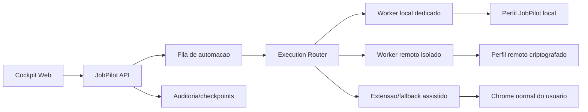

# JobPilot: estrategia para automacao sem prender o navegador do usuario

Status: proposta de arquitetura
Data: 2026-05-30

## Problema

Hoje o caminho de produto usa `JOBPILOT_BROWSER_DRIVER=extension`.

Fluxo atual:

1. `apps/api` inicia um processo do `apps/agent`.
2. O agente cria comandos na API.
3. `apps/extension` busca comandos por polling.
4. A extensao executa comandos na aba real do Chrome do usuario.
5. A API registra eventos, fila, checkpoints e auditoria.

Isso resolve o problema de sessao: o usuario ja esta logado no LinkedIn. Mas cria um problema de produto: busca e candidatura competem com o uso normal do navegador. Se o usuario troca de aba, fecha o Chrome, navega em outro site, ou o LinkedIn redireciona, a automacao fica fragil.

## Restricao externa importante

LinkedIn nao oferece um caminho publico simples para "aplicar em vagas em nome do usuario" por API para este caso. Alem disso, a documentacao oficial do LinkedIn diz que softwares de terceiros, bots, plugins/extensoes que raspam dados, modificam a aparencia ou automatizam atividade no site podem violar as regras da plataforma.

Implicacao: a arquitetura mais vendavel nao deve ser "bot invisivel aplicando em massa". Deve ser automacao assistida, auditavel, com limites, consentimento claro, checkpoints e revisao humana nos pontos sensiveis.

## Opcoes consideradas

### Opcao A: continuar extension-first no navegador do usuario

Descricao: manter o modelo atual. A extensao observa e age na aba do usuario.

Vantagens:

- Usa a sessao real do usuario sem pedir senha.
- Mais simples para MVP local.
- O usuario ve o que esta acontecendo.
- Boa para onboarding e para depurar conectores.

Problemas:

- Prende/interfere no navegador do usuario.
- Depende do Chrome aberto e da aba correta.
- Polling de extensao adiciona latencia.
- Mais fragil se o usuario usa o navegador enquanto o agente trabalha.
- Escala mal para produto SaaS.

Conclusao: boa para MVP e fallback assistido, ruim como arquitetura final principal.

### Opcao B: servidor com senha do LinkedIn do usuario

Descricao: usuario fornece email/senha e o servidor faz login em browsers controlados.

Vantagens:

- Roda sem depender do navegador do usuario.
- Facil de enfileirar execucoes em background.

Problemas:

- Alto risco de seguranca e confianca.
- 2FA/captcha tornam o fluxo instavel.
- Armazenar ou trafegar senha de LinkedIn e um pessimo produto.
- Aumenta risco de bloqueio/restricao de conta.

Conclusao: nao recomendado.

### Opcao C: servidor com importacao de cookies/sessao via extensao

Descricao: extensao exporta cookies/local storage do LinkedIn para o servidor, que reutiliza a sessao.

Vantagens:

- Evita pedir senha.
- Permitiria execucao em background.

Problemas:

- Alto risco de seguranca: cookies de sessao equivalem a acesso a conta.
- Exige permissoes sensiveis na extensao.
- Dificil explicar e vender com confianca.
- Tende a violar expectativa do usuario e pode criar risco de plataforma.
- Sessoes podem invalidar por IP/device fingerprint diferente.

Conclusao: nao recomendado como produto.

### Opcao D: browser dedicado local em segundo plano

Descricao: instalar um runtime local que abre um Chrome/Chromium separado, com perfil dedicado `JobPilot`, enquanto o usuario continua usando o Chrome normal. O usuario faz login nesse perfil uma vez.

Vantagens:

- Nao prende o navegador principal do usuario.
- Nao precisamos armazenar senha.
- Mantem dados e cookies no computador do usuario.
- Usa a mesma automacao Playwright/driver, mas em perfil isolado.
- Mais simples e seguro que enviar sessao para servidor.
- Funciona como ponte entre MVP local e produto instalavel.

Problemas:

- Ainda depende da maquina do usuario ligada.
- Para SaaS puro, nao resolve execucao cloud.
- Pode sofrer com captcha/2FA e restricoes do LinkedIn.
- Precisa de instalador/runtime local robusto.

Conclusao: melhor proximo passo pragmatico.

### Opcao E: browser remoto gerenciado pelo JobPilot

Descricao: JobPilot provisiona um browser isolado por usuario em infraestrutura propria. O usuario abre uma sessao remota segura, faz login manualmente no LinkedIn uma vez, e depois o servidor executa nesse browser isolado.

Vantagens:

- Nao prende navegador do usuario.
- Permite filas, agendamento e execucao em background.
- Cada usuario tem perfil isolado, auditavel e revogavel.
- Nao precisamos conhecer a senha.
- Melhor arquitetura para SaaS, se aceitarmos o risco de automacao assistida.

Problemas:

- Infra mais complexa: browsers persistentes, storage criptografado, isolamento, filas, limites.
- Custo maior por usuario.
- Login pode exigir 2FA/captcha em browser remoto.
- Acesso vindo de datacenter pode parecer suspeito para plataformas.
- Precisa politicas fortes de rate limit e revisao humana.

Conclusao: bom alvo de medio prazo, mas nao deve ser o primeiro salto.

### Opcao F: conectores oficiais / ATS diretos

Descricao: para sites que nao exigem login LinkedIn, ou ATS como Greenhouse, Lever, Gupy, InHire, etc., o servidor acessa diretamente a pagina de candidatura ou APIs disponiveis.

Vantagens:

- Mais adequado a servidor.
- Nao depende da sessao do LinkedIn quando a candidatura e externa.
- Melhor para filas e execucao em background.

Problemas:

- Cada ATS tem formato proprio.
- Upload de arquivo e perguntas sensiveis exigem checkpoints.
- Alguns sites tem anti-bot/captcha/login.

Conclusao: deve ser parte central da arquitetura. LinkedIn vira fonte/triagem; aplicacoes externas devem migrar para conectores servidor-side quando possivel.

## Recomendacao

Adotar arquitetura hibrida em tres camadas:

1. Assistido no navegador do usuario: extensao atual continua para MVP, onboarding, debug, aprovacao humana e fallback.
2. Worker local dedicado: proximo passo. Um browser separado do JobPilot roda em background com perfil proprio, sem prender o Chrome do usuario.
3. Worker remoto isolado: alvo SaaS. Browser persistente por usuario, login manual em sessao remota, storage criptografado, filas e limites.

O ponto chave: a extensao deve deixar de ser "o executor principal permanente" e virar "ponte de consentimento, revisao e fallback".

## Arquitetura alvo

## Modelo de execucao recomendado

### Busca de vagas

Preferencia:

1. Servidor/worker remoto para fontes que nao exigem login ou que tenham conector seguro.
2. Browser dedicado local/remoto para LinkedIn quando o usuario autorizou e a sessao esta pronta.
3. Extensao no Chrome do usuario apenas para fallback ou busca assistida.

### Aplicacao de vagas

Preferencia:

1. ATS externo com conector servidor-side quando possivel.
2. Browser dedicado local/remoto para formularios com sessao persistente.
3. Extensao no Chrome do usuario quando for preciso intervencao humana, login, captcha, upload manual, ou revisao final.

## Politicas de seguranca/produto

- Nunca pedir ou armazenar senha do LinkedIn como caminho padrao.
- Nunca exportar cookies do navegador do usuario para o servidor.
- Auto-submit deve ser opt-in explicito, com limites por dia/execucao.
- Review-only deve ser o padrao para LinkedIn ate termos alta confiabilidade.
- Captcha, 2FA, login suspeito, upload local e perguntas sensiveis sempre viram checkpoint.
- Toda acao precisa gerar auditoria: vaga esperada, URL real, campos preenchidos, motivo, risco e resultado.
- Se o site redirecionar para outra vaga, parar com `job_mismatch`.
- Para produto comercial, comunicar claramente que e automacao assistida e respeita revisoes/limites.

## Roadmap tecnico

### Fase 1: separar "execution target" do agente

Criar entidade/configuracao:

- `ExecutionTarget`: `extension`, `local_dedicated_browser`, `remote_browser`, `server_connector`
- `ExecutionSession`: usuario, plataforma, status, ultima atividade, capacidade, riscos
- `BrowserProfile`: local/remoto, criptografado/revogavel, plataforma, estado de login

O agente nao deve saber se esta executando no Chrome do usuario, no browser local dedicado ou no browser remoto. Ele deve falar com uma interface unica.

### Fase 2: worker local dedicado

Implementar primeiro porque e o melhor salto pratico:

- Abrir browser separado com perfil `JobPilot`.
- Tela de onboarding: "Conectar LinkedIn no navegador dedicado".
- Usuario loga uma vez nesse browser.
- Automacao roda nesse browser, sem controlar o Chrome normal.
- Extensao permanece opcional para fallback e revisao.

### Fase 3: roteador de execucao

Antes de cada tarefa, escolher o melhor alvo:

- `server_connector` se for ATS suportado e sem login complexo.
- `local_dedicated_browser` se a plataforma exige sessao e o usuario tem runtime local.
- `remote_browser` quando o SaaS estiver pronto.
- `extension` se precisar da aba real do usuario.
- `manual_only` se risco alto ou plataforma sem suporte.

### Fase 4: worker remoto isolado

Somente depois de provar o worker local:

- Um browser/profile por usuario.
- Storage criptografado.
- Revogacao de sessao pelo usuario.
- Visualizacao ao vivo ou replay.
- Fila com rate limit.
- Health checks e encerramento automatico.

### Fase 5: reduzir dependencia do LinkedIn

Tratar LinkedIn como fonte de descoberta e Easy Apply assistido, mas investir em conectores diretos para ATS externos:

- InHire
- Gupy
- Greenhouse
- Lever
- Workday, se for viavel

Isso aumenta o percentual de aplicacoes que podem rodar no servidor sem usar a conta LinkedIn.

## Decisao proposta

Nao migrar diretamente para "servidor controla a conta LinkedIn".

Implementar primeiro um worker local dedicado, com perfil separado do JobPilot. Ele resolve o problema mais doloroso do usuario, que e nao prender o navegador principal, sem criar agora o risco de senha/cookie no servidor.

Em paralelo, preparar o codigo para `ExecutionTarget`, porque esse mesmo contrato permite depois trocar o executor para browser remoto ou conector servidor-side sem reescrever o agente.

## Impacto no estado atual do codigo

Arquivos mais afetados:

- `apps/api/Services/AutomationProcessService.cs`: hoje decide `browserDriver` por env var. Deve passar a decidir `ExecutionTarget`.
- `apps/agent/Program.cs`: hoje alterna `playwright` e `extension`. Deve receber uma sessao/target abstrato.
- `apps/agent/Browser`: deve concentrar os drivers local dedicado, remoto e extensao atras da mesma interface.
- `apps/extension`: deve continuar como canal de consentimento/fallback, nao como unico executor.
- `apps/web/src/App.tsx`: deve mostrar status de sessoes: extensao, worker local, browser remoto, checkpoints.

## Criterio de sucesso

O JobPilot sera considerado alinhado com essa estrategia quando:

- O usuario conseguir iniciar busca/aplicacao sem perder o uso do Chrome principal.
- O sistema tiver pelo menos um browser dedicado separado para execucao.
- O roteador escolher o executor certo por plataforma/situacao.
- LinkedIn Easy Apply nunca aplicar em vaga diferente da esperada.
- `autoSubmit=false` nunca enviar candidatura.
- Toda tarefa tiver auditoria e checkpoint em caso de risco.
- A extensao continuar util, mas nao obrigatoria para toda execucao.
